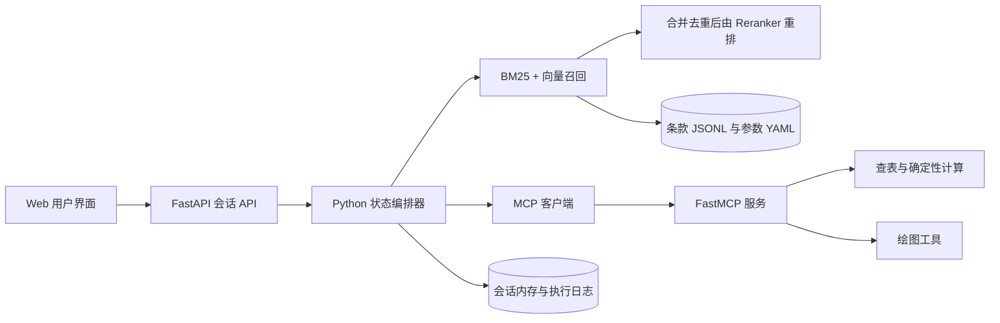
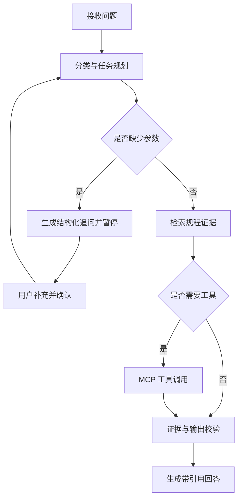

# 技术规程问答 Agent 技术实现方案

## 1. 目标与实现边界

本项目交付一个可现场演示的 Web 版技术规程问答 Agent，围绕《CJJ 181—2012 城镇排水管道检测与评估技术规程》完成条文问答、检测方案比较、参数追问、RI 等规程计算和曲线绘制。回答、计算依据和建议均限制在该规程原文内；规程没有规定的事项必须明确答复“依据 CJJ 181—2012 原文无相关规定，不作推测性补充”。

采用 Spec 驱动开发：先把可观察的用户行为、输入输出、拒答边界和验收例子写成版本化规格，再实现服务与界面。每个需求都能追溯到一个 Spec、实现模块和验收用例。LLM 负责理解、规划和表达；条款查证、参数校验、计算、等级判定和图表数据由确定性组件完成。

当前仓库已有项目章程和九题需求基线，但尚无应用代码和部署约束。因此，本文件补充架构与实现方案，不替换 `specs/00-constitution.md`、`specs/01-requirements.md`，也不声称应用已经开发或测试通过。落地前需完成规程条款与计算参数的结构化核验，尤其是计算公式、分档边界和处置结论。

## 2. 需求约束与产品行为

| 需求 | 系统行为 | 验收关注点 |
|---|---|---|
| 唯一知识来源 | 检索库只接纳指定 CJJ PDF 经核验的内容；不调用开放域搜索，不混入外部知识 | 每个事实性结论都有条款号和原文证据；库外问题按统一话术答复 |
| 条文问答 | 检索条款并生成简明回答，展示引用条款及证据片段 | 引用真实存在、语义支持结论，不允许模型编造条号或数值 |
| 比较与方案规划 | 将问题拆成规程依据、场景条件、对比维度、结论；缺少决策条件时先追问 | 比较覆盖用户指定维度；理由逐项带依据；不能把推荐说成规程强制要求 |
| 计算 | 识别计算类型与参数，检查完整性，调用 MCP 计算工具并解释返回结果 | 缺项时只追问，不调用计算；过程值、公式、输入、单位、出处完整 |
| 会话记忆 | 同一会话内保存用户已确认参数及其来源、时间和适用管段 | 复用前展示或确认参数范围；新管段/冲突值不得静默覆盖 |
| 可视化 | 将工具返回的数值序列绘制为可查看图表 | 图表来自实际计算结果，坐标、单位、变量值明确，可下载数据 |
| 演示与自查 | UI 展示规划、检索、MCP 调用、交互追问和异常；形成九题答卷与自查材料 | 模块三运行时日志可见；答卷逐题标注条款与证据 |

### 不在第一阶段范围

- 不把 Agent 输出作为检测、修复施工或安全作业的最终审批结论。
- 不从规程以外推导工程经验，不自动补齐未知数据，不对低置信 OCR 文本计算。
- 不做用户、管网、检测报告等复杂业务管理；第一阶段只需要演示所需的会话和审计数据。
- 不让 LLM 自由编写或执行 Python/SQL，也不允许它绕过参数校验直接得出计算结果。

## 3. 技术架构

首版采用混合检索与重排：按条款切分的 JSONL 作为权威语料，BM25 负责关键词召回，向量检索负责语义召回；两路候选合并、去重后直接交给 reranker，按查询与证据的相关性重排并截取最终结果。章节、条款号和内容类型过滤及精确条款匹配优先执行。参数表用人工核验的 YAML。向量索引与语料版本绑定，可本地构建和重建，不要求独立向量数据库服务。



### 3.1 推荐组件

| 层 | 首版建议 | 职责 |
|---|---|---|
| 前端 | React，独立进程 | 页面包含对话、计划与 MCP 日志、当前槽位；不由 API 进程提供 |
| API | Python 3.11+、FastAPI | 只管理会话、导入、审核和健康检查，不返回页面 |
| Agent 编排 | Python 显式状态机/流程编排器、Pydantic | 受控节点、追问暂停/恢复、参数校验和调用轨迹；不引入不必要的工作流框架 |
| RAG 入库与检索 | LlamaIndex `IngestionPipeline` + Chroma 本地持久化 + BM25 + reranker | Web 导入并预览切片、选择 embedding profile；保留原文/DocMind 页码与版面 metadata；BM25 与向量候选合并去重后直接 rerank，不使用 RRF |
| MCP | FastMCP 独立进程、Streamable HTTP | 隔离条款/参数查询、确定性计算和绘图；强 Schema、调用记录和超时策略 |
| 规则数据 | JSONL + YAML | YAML 保存审核后的分值/参数表和公式版本；OCR 草稿不直接进入运行时规则 |
| 数值计算 | Python 纯函数 + `decimal.Decimal` | RI/MI、中间量、等级和边界比较；不由模型计算或查表 |
| 图表 | Matplotlib 输出 PNG | 绘图工具基于计算点生成图片和坐标数据，前端直接展示 |
| 会话与日志 | 演示版按 `session_id` 存在进程内存 | 满足单实例现场演示；明确进程重启会清空会话。多实例/长期保存不列入首版 |
| 模型接入 | OpenAI 兼容 HTTP 接口，密钥/地址放环境变量 | 模型只处理意图、槽位抽取、规划和行文；供应商可替换 |
| 部署 | Docker Compose | 前端、API、MCP 三个服务；前端把 `/api` 转到 API，并提供健康检查 |

技术依赖应在实现前用锁文件固定版本。MCP 调用失败按项目基线最多重试一次；再次失败则停止本轮计算并明确展示失败。模型供应商封装为接口，便于演示环境更换模型；无模型时仍可独立演练检索、查表与计算工具。

### 3.2 关键模块边界

1. **规程解析与发布**：PDF 入库、页码/章节/条款切分、OCR/表格校验、人工审核、版本发布。未审核内容不进入可回答索引。
2. **检索与引用**：只返回带来源元数据的 `ClauseEvidence`，不得把裸文本交给生成节点。低相关度或证据不足时触发拒答/澄清。V1 文档导入和向量索引详见 `specs/006-rag-ingestion-v1.md`。
3. **问题分类与规划**：识别条文问答、比较、方案、计算、绘图或复合任务；将复合请求拆为有向任务步骤。LLM 可选择已注册节点，不可创造工具或改写工具参数语义。
4. **参数槽位与会话状态**：由计算定义中的参数 Schema 生成缺项清单；记录值、单位、用户确认状态、来源消息和关联管段 ID。
5. **计算引擎**：独立纯函数，接收通过 Schema 校验的参数，返回公式、参数追踪、逐步结果、等级、边界检查和引用条款。
6. **MCP 接入层**：工具注册白名单、输入/输出结构校验、deadline、幂等键、重试策略、异常映射、调用日志和版本追踪。
7. **回答合成**：只根据检索证据和工具输出组织答案；输出前运行引用一致性和必需字段检查。
8. **可观测与审计**：保存计划步骤、检索命中、参数变化、工具输入输出摘要、耗时、重试和最终引用，不记录不必要的敏感信息。

## 4. Spec 驱动开发流程

### 4.1 仓库产物

```text
specs/
  README.md                         # 规格索引、状态、变更流程
  001-knowledge-and-citations.md    # 唯一知识源、检索、引用与拒答
  002-agent-dialogue.md             # 分类、规划、追问、会话状态与失败恢复
  003-calculation-mcp.md            # 参数目录、计算工具、等级与曲线
  004-web-demo-and-deliverables.md  # UI、演示、九题答卷、自查与验收
```

每个 Spec 必须包含：背景/目标、非目标、角色与主流程、Given/When/Then 验收场景、输入输出 Schema、失败与边界行为、来源条款/证据、依赖和未决问题。需求变更先修改 Spec，再改实现和测试；Spec 与实现不一致时以已批准 Spec 为准，并在 PR 中说明偏差。

### 4.2 推荐开发阶段与门禁

| 阶段 | 主要工作 | 可检查产物 / 退出条件 |
|---|---|---|
| 0. 规程基线 | 盘点 PDF 页码、章节和条款；识别扫描页与表格；抽取术语、方法适用条件、检测周期、计算表格 | `data/source_manifest.json`、审核后的条款/参数清单；所有计算关键数据双重核对并记录页码/条款 |
| 1. Spec 冻结 | 将本方案的四份功能 Spec 转成首版验收契约，厘清 MI/RI 定义、参数字段、图表、部署模型 | 所有 P0 场景有明确输入输出和规范出处；未决项列入决策记录 |
| 2. 知识与引用纵切片 | 建条款模型、BM25 与向量索引、候选合并去重和 rerank、带引用回答及无依据拒答 | 关键词与语义查询均能召回正确原文页/条款；候选合并、重排效果、引用校验和不可回答场景通过验收 |
| 3. 计算与 MCP | 录入经核验的参数目录；实现缺陷分值、RI/MI 计算工具和绘图工具；接入 MCP 调用日志 | 公式/边界/舍入有参考案例；工具输出可追溯；缺参数不调用计算 |
| 4. Agent 与会话 | 构建状态图：分类→规划→检索/追问→工具→校验→作答；支持中断续答和同会话参数记忆 | 9 道题的主路径均能按 Spec 演练；错误可恢复，未知不编造 |
| 5. Web 演示与交付 | 完成对话、计划/工具日志、图表、错误态、九题答卷和自查说明 | Docker Compose 本地启动成功；演示脚本完成；证据截图和材料齐全 |

### 4.3 TDD 开发方式

功能实现采用 TDD（测试驱动开发），并与 Spec 驱动流程衔接：Spec 定义“系统应该做什么”，测试把验收场景转成可执行检查，代码再实现这些行为。开发一个需求前，先确认对应 Spec 已明确正常路径、边界条件和失败行为；规格不清楚时先补规格，不用测试替未决规则做决定。

每个小功能按 **Red → Green → Refactor** 循环推进：

1. **Red：先写失败测试。** 从 Given/When/Then 场景提取一个最小案例，测试名称或注释标明需求 ID/场景 ID；运行后确认它因目标行为尚未实现而失败。
2. **Green：实现最少代码。** 只实现让该测试通过的行为，并运行相关测试；不在此步顺手扩展未经规格定义的行为。
3. **Refactor：整理实现。** 在测试仍通过的前提下清理重复逻辑、模块边界和命名；改动后重跑相关测试。
4. **回归：扩大验证范围。** 一个需求的场景完成后运行对应模块测试，再运行完整测试集；修复导致的回归后才进入下一需求。

测试分层与项目边界对应：

| 测试层 | 先覆盖的行为 | 实施约定 |
|---|---|---|
| 单元测试 | 计算纯函数、参数与单位校验、分档边界、拒答规则、引用校验 | 优先用固定输入和人工复核算例；计算关键边界逐项覆盖，不依赖模型或网络 |
| 组件/契约测试 | BM25 与向量双路召回、候选合并去重、reranker 排序、条款数据格式、MCP 输入输出 Schema、工具错误映射 | 使用小型核验夹具或替身；验证召回、候选集合与重排顺序、条款来源、结构、超时/异常契约 |
| 集成测试 | Agent 状态流转、追问暂停恢复、工具调用与幂等、API 会话行为 | 使用可控模型/MCP 替身，断言调用参数、次数、顺序及最终可见结果 |
| 验收测试 | 九题及库外问题、缺参、冲突参数、伪造条款等端到端行为 | 逐条对应 Spec 的 Given/When/Then；真实模型运行结果另作演示验收，不替代确定性回归测试 |

LLM 输出具有非确定性，核心规则测试不得依赖真实模型的自由生成结果。通过固定模型响应或 stub 验证编排、参数校验、工具选择和引用约束；模型提示词或供应商变更时，另用固定评测集检查行为变化。每个缺陷修复都先增加能够复现问题的测试，再修复代码，避免回归。

### 4.4 Definition of Done

- 所有用户可见行为都有 Spec 场景、自动化验收用例和对应需求 ID。
- 条款、公式、等级阈值和处置文字都能追踪到 CJJ 条文/表格；计算关键值未人工核验前不发布。
- 每个工具均有输入输出 JSON Schema、超时、异常、日志和边界测试。
- 回答能展示真实规划与 MCP 记录；有依据/无依据、信息完整/缺失、成功/失败均有可复现演示。
- 部署、初始化、测试答卷和自查说明由干净环境步骤复现；结果与 Spec 一致。
- 新增或修复的行为遵循 Red → Green → Refactor；测试能追溯到需求 ID/Spec 场景，相关回归测试通过。

## 5. 规程数据与知识检索设计

### 5.1 来源处理流程

PDF 文件哈希固定为一个资料版本；先保留原始页码，再按条款切分。页面扫描或表格抽取质量不足时使用 OCR 辅助，但 OCR 结果必须人工对照 PDF 原页复核。公式、上下标、表格分值、等级边界、黑体强制条文不得仅依赖 OCR 自动发布。

推荐条款记录：

```json
{
  "source_id": "cjj181_2012_pdf_sha256",
  "edition": "CJJ 181-2012",
  "page": 0,
  "chapter": "第X章",
  "clause_no": "X.Y.Z",
  "title": "条款标题",
  "text": "经核验的原文或忠实摘录",
  "content_type": "normative_text|table|formula|definition",
  "review_status": "approved",
  "reviewed_by": "reviewer-id",
  "source_hash": "sha256"
}
```

页码采用 PDF 阅读器页序并另存印刷页码，回答显示条款号为主、印刷页码辅助。扫描 OCR 文本与原件分开保存，只有 `approved` 内容可以进入检索与计算。

### 5.2 混合检索与回答契约

- 先按规程版本、章节、内容类型等元数据过滤，并对条款号/表号查询执行精确匹配；其余查询并行执行 BM25 关键词召回和向量语义召回。
- 合并 BM25 与向量召回的候选并按证据 ID 去重，再调用 reranker 按查询与候选证据的相关性重排，截取最终 top-k。精确条款号/表号命中应保留优先级，避免语义重排将确定性命中降出结果。
- 保留 BM25 分数、向量分数、reranker 分数、最终名次和命中来源，便于审计与调参。具体 embedding/reranker 模型、各路候选数量、最终 top-k 和证据阈值由标注查询集评估后确定，不在未评估前写死。
- 向量索引只包含 `approved` 内容，并与规程版本、分块规则、embedding 模型版本绑定；这些信息变化时重建索引。向量召回不得使未审核 OCR 内容进入证据集。
- 将每个证据块作为 `{clause_no, page, quote, source_hash}` 返回；生成回答只允许引用此集合中的条款号。
- 相关度不足、证据之间冲突或用户要求超出规程范围时，使用固定拒答模板或提出澄清问题。
- 同一条款多段命中时合并展示但保留各自页码；对比答案采用维度×方法表格，并在各单元格或表后注明依据。
- 回答中的“规程规定”“建议选择”“本系统计算结果”使用不同措辞，避免把工程推荐误述成强制要求。

## 6. Agent 状态图与参数记忆

建议状态图：



每个节点输入输出都用 Pydantic 类型约束。任务规划以受控步骤列表表示，例如 `retrieve_clauses → collect_parameters → calculate_RI → plot_curve → validate_answer`，执行引擎按白名单运行。需要补充参数时保存图状态并等待用户继续，不重新执行无关步骤。

会话参数按 `session_id + subject_id(pipe_segment_id)` 隔离，保存参数名、标准化值、单位、来源、确认状态和更新时间。用户说“这条管道”时仅复用当前明确关联的管段；换管段、单位不明、前后冲突时要求确认。会话记忆不是规程事实来源，不能自动填充用户未提供的工程数据。

## 7. 计算与 MCP 工具契约

### 7.1 工具集合

| 工具 | 输入 | 输出 |
|---|---|---|
| `search_clauses` | 查询、可选章节/条款、返回条数 | 条款号、页码、原文证据、来源版本、相关度 |
| `get_calculation_schema` | 计算类型、规程版本 | 必填参数、单位、枚举/范围、作用解释、出处、版本 |
| `lookup_defect_score` | 缺陷类型、等级、位置/条件（依核验后的规则） | 分值、匹配规则、条款/表格出处；无唯一匹配时返回需澄清 |
| `calculate_RI` / `calculate_MI` | 经过校验的参数对象、计算定义版本 | 使用公式、归一化输入、各中间项、最终值、等级/处置结论、引用条款 |
| `plot_curve` | 变量名、固定参数、变量序列、计算结果序列、单位、标签 | 图表文件或图表 URL、可下载数据、坐标说明、每个点的数值 |

工具实际名称及 `MI` 的业务含义以条款审核与规格决策为准；没有确认的定义不得仅因任务说明提及“RI/MI”就自行补齐。

### 7.2 计算安全与可追溯

- 公式、参数分档和等级阈值以有版本号的 JSON/YAML 规则目录维护，规则字段必须包含条款/表号、页码、审核人和原 PDF 哈希。
- 计算实现采用纯函数；输入 Schema 校验单位、数值范围、枚举和必填项。单位换算显式记录，不隐式猜测。
- 每个结果保留 `calculation_id`、规则版本、代码版本、输入快照、公式、分步结果和证据引用，便于复算。
- 明确空值、分档边界、舍入位数、缺陷合并/空间间距、无缺陷等规则；这些细节必须从规程摘录并形成 Spec，不在此处预设。
- 工具返回“不支持/参数歧义/输入越界”时转为结构化追问或解释，不通过 LLM 自己估值。

### 7.3 MCP 失败策略

- 计算与绘图请求设置短 deadline，并在日志显示工具名称、调用 ID、耗时和状态。
- 对确定性只读查询可有限重试；计算请求使用相同幂等键，防止重复记录。参数错误不重试，Schema 错误直接失败。
- 工具超时后保留计划和输入，让用户可重试；不得展示未返回的计算结果。检索服务不可用时说明无法验证条款，不生成法规答案。
- 重试上限、退避间隔、各工具超时和降级提示由配置管理并纳入 Spec；不得无限由模型决定重试。

## 8. Web 界面与演示体验

单页布局建议包含：

1. **主对话区**：用户问题、Agent 回答、结构化追问表单和参数确认卡片。
2. **依据区**：引用条款号、PDF 页码、证据原文折叠展开。
3. **执行详情区**：规划步骤、检索命中、MCP 请求/响应摘要、耗时、重试和异常状态；默认演示时可见，不能隐藏模块三日志。
4. **图表区**：RI 随 K 变化与 RI 随 T 变化的曲线，显示实际点值、计算配置和出处；提供 SVG/PNG 与 CSV 下载。
5. **演示问题集**：九道固定问题一键填入，但每题仍按真实 Agent 流程运行；截图应覆盖追问、MCP 调用、图表和引用。

日志采用分层详情：普通观众可看计划和工具结果摘要；工程排查可展开 Schema、耗时、错误码和重试信息。不得把模型私有思维链作为“规划日志”；展示可审计的任务步骤、检索证据和工具调用事实。

## 9. 验收方案与交付物

### 9.1 九道题映射

| 题号 | 主要 Spec | 验收点 |
|---|---|---|
| 1 | 001 | 编制目的、适用范围都有原文证据和条款号 |
| 2 | 001、004 | 三种术语定义与适用条件分开回答，比较结论有依据 |
| 3 | 001 | 周期与缩短情形均引用正确条款；不自行增加条件 |
| 4 | 001、004 | 五种方式按四个指定维度对比，并给明确但有边界的选择结论 |
| 5 | 001 | 声纳限制、检查井先后顺序和检查项目分别有依据 |
| 6 | 001、002、004 | 依已有 Spec 追问积泥是否埋没探头、流速、管段长度和竣工资料；不得推荐违反电视检测、人员进入、潜水等限制的方式 |
| 7 | 003 | 查询 K 分档、固定其他参数；计算 K=0/3/6/10，各点由 MCP 返回并绘出曲线 |
| 8 | 002、003 | 列尽 RI 必填参数、作用、条款；缺项时不调用计算器、不返回 RI |
| 9 | 002、003 | 第一问对“流砂”先按表 8.3.4-3 追问土质列，不得自行映射；第二问用户明确给定 T=0/6/8/10 时按确认参数逐点计算并绘图 |

第 6 题的现场约束和条款位置已在 `specs/01-requirements.md` 具体化；实现需遵守其中的水位、管径限制，并且不得把题目没有规定的埋深/管材/道路等级臆造成方法否决条件。第 9 题的缺陷计数、E、K、T 映射以 `specs/01-requirements.md` 的分步标准为准。第 6 题必须保留“追问—补充—规划—检索—结论”完整记录；第 7 至 9 题保留工具输入输出、证据条款和图表。测试答卷不可手工编造运行截图；截图对应实际构建版本和实际会话。

### 9.2 核心质量指标

- **引用正确率**：回答条款号存在且证据直接支持对应结论；关键事实要求全量人工审核。
- **拒答正确率**：对无条文依据的问题不扩写或给出外部知识。
- **参数完整性**：参数不全、冲突或单位不明均在计算前阻断。
- **计算一致性**：工具结果与人工复核的规程样例一致，包括中间值、边界和舍入。
- **执行透明度**：每次规划步骤及 MCP 调用均可在 UI 查到成功/失败和结果摘要。
- **图表一致性**：绘图点值逐项等于计算工具返回值，坐标标签和变量单位正确。

验收集至少包含九个任务题、库外问题、伪造条款问题、近似术语、缺参、单位冲突、分档边界、工具超时、重复提交、会话换管段和规程内容检索不到等用例。

### 9.3 任务说明要求的交付物

1. 可运行的 Web Agent：启动说明、演示账号/本地入口、规划和 MCP 日志、可视化。
2. 测试答卷：九题完整答案、条款引用、必要的交互/工具日志/图表截图。
3. 自查说明：能力边界、已知缺陷、超时失败策略、智能问数判定边界和后续计划。
4. 现场答辩材料：架构图、技术选型、核心链路、边界决策与异常演示脚本。

## 10. 风险、未决决策与下一步

### 10.1 主要风险控制

| 风险 | 影响 | 控制方式 |
|---|---|---|
| 扫描 PDF 的 OCR 将公式/表格识错 | 错误答案或错误工程计算 | OCR 只用于提取辅助；关键表格逐项人工复核并保存页图/审校记录 |
| 大模型补充常识或伪造条款 | 违反唯一来源约束 | 证据白名单、固定拒答、输出引用校验、禁止联网检索 |
| 复杂问题被当成单轮问答 | 漏问参数、跳过工具或错误流程 | 用状态图定义可恢复步骤，Spec 覆盖组合任务 |
| 公式实现正确但参数口径不一致 | 结果不可信 | 每个参数定义单位、来源、边界、缺省值策略和测试样例；无默认值除非规程明确规定 |
| MCP 调用失败后展示旧结果 | 误导用户 | 结果绑定 calculation_id 与当前输入哈希；失败清除“当前结果”态 |
| 会话记忆串用不同管段 | 错算 | 参数按管段实体隔离，切换目标清空/确认，不使用隐式全局记忆 |

### 10.2 开始编码前必须冻结的决策

1. 是否只交付本地 Docker Compose 演示，还是要部署到指定服务器/云环境。
2. 指定 LLM/API 是否已有；若无，确定允许使用的本地或云模型和网络限制。
3. 规程是否允许作为可检索全文保存，以及 PDF 页码展示方式。
4. `MI` 在任务中的具体含义、计算公式与适用范围；以原文或任务方补充规格确认。
5. 公式表、缺陷分值表、参数分档、等级边界、舍入规则及第 9 题输入映射的逐项审校结果。
6. MCP 服务的演示传输方式和是否需要多进程/容器隔离。

### 10.3 推荐立即执行的下一步

先完成阶段 0：将九题涉及的术语、检测方法、周期、声纳限制、检查井检查、缺陷分值、RI 参数/公式/等级和处置条文整理成带页码的审核清单；再确认第 8 题必填项与第 9 题的变量映射。完成后冻结四份 Spec，再从“条文检索 + 可靠引用”和“一个可人工复核的计算工具”两个纵切片开始编码。
