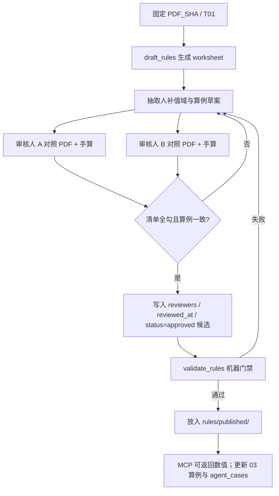

# 008 计算规则双人审核（T03）

状态：Draft  
范围：把 CJJ 181—2012 中的缺陷分值、RI/MI 公式、参数表与等级处置，变成可发布的 MCP 规则包。  
关联：`../03-design/calculation-rules.md`、`calculation-mcp.md`、`../06-delivery/tasks-and-gates.md` T03、`pipe_assessment_mcp/rules/`。

## 1. 为什么要双审

计算输出会被演示和答卷当作规程结论。OCR/草稿/模型记忆都不可信。  
**两人对照同一 PDF 哈希独立核验**，才能把规则标为 `approved`；否则一律 `RULE_NOT_PUBLISHED`。

双审对象是**计算规则包**，不是条文检索索引（条文审核见 `rag-ingestion-v1.md`）。二者都要过，但清单不同。

## 2. 交付物与目录

```
pipe_assessment_mcp/rules/
├── README.md
├── CHECKLIST.md                 # 本 Spec 的操作摘要
├── worksheets/                  # 待审草稿（pending_review，永不被 rulebook 加载）
│   ├── RI.pending.json
│   ├── MI.pending.json
│   └── defect_score.pending.json
├── reviews/                     # 审签记录（一人一份）
│   └── YYYYMMDD-<kind>-<reviewer>.md
└── published/                   # 仅放通过门禁的包（可选；也可用本目录根下 RI.json）
    └── RI.json
```

运行时加载顺序（见 `rag.calculation.rulebook`）：

1. `RULE_FIXTURE=1` → `agentEval/fixtures/rules/`（仅评测）  
2. `RULES_DIR` 或默认 `pipe_assessment_mcp/rules/published/` 与 `pipe_assessment_mcp/rules/`  
3. **忽略** `worksheets/` 与任何 `status != approved` / `fixture_only` 文件  

## 3. 角色

| 角色 | 职责 | 禁止 |
|---|---|---|
| 抽取人 | 用 `python -m rag.draft_rules <kind>` 生成 worksheet；补全值域/算例草案 | 自行把 `status` 改成 `approved` |
| 审核人 A | 对照 PDF 勾选清单；手算至少一组 `reference_cases` | 与 B 共用同一份未独立核对的结论 |
| 审核人 B | 同上，**独立**完成；两人登录名必须不同 | 复制 A 的签字日期与结论而不翻 PDF |
| 发布人 | 跑 `python -m pipe_assessment_mcp.validate_rules`；通过后写入 published | 跳过校验脚本；把夹具包拷进 published |

同一人不得兼任 A 与 B（`reviewers` 去重后长度 ≥ 2）。

## 4. 审核范围（按包）

### 4.1 `defect_score`（表 8.2.3 / 8.2.4 等）

- [ ] `source_hash` = 仓库锁定的 PDF SHA（`rag.source.PDF_SHA`）  
- [ ] 每行：缺陷名称、等级、分值与 PDF 表行一致；出处条款/表号、`page_pdf` 可定位  
- [ ] 无「猜补」空行；不完整表在审签中注明缺口，缺口行不得进入 published  
- [ ] 至少 2 条人工抽查行记入 `reference_cases` 或 `reviews/` 手算记录  

### 4.2 `RI`（式 8.3.4、表 8.3.4-1/2/3、表 8.3.5）

- [ ] 公式文本与系数与原文一致（不得沿用夹具加权冒充已审）  
- [ ] 字段 F/K/E/T（及推导路径）单位、上下界齐全；禁止 `maximum: null` 带病发布  
- [ ] K/E/T 分档表项与 PDF 一致；「流砂」等非表列名不得写死映射  
- [ ] 等级 `bands` 上界、grade、advice 与表 8.3.5 一致  
- [ ] `reference_cases` ≥ 2，且用计算器复算与手算一致（含题 7 四点或等价）  
- [ ] 题 9 所需：缺陷→S/Smax/F、间距分组与 α，在**领域扩展包**或同版本附录中单列审签（未完成则 `AG-T09` 保持 blocked）  

### 4.3 `MI`（式 8.4.x、表 8.4.5）

- [ ] 与 RI **分文件**维护；不得共用 RI 槽位冒充  
- [ ] 公式、字段、分档、处置全文核验  
- [ ] `reference_cases` ≥ 2  
- [ ] 未完成前生产路径对 MI 请求必须阻断（`AG-T-MI-01`）  

## 5. 规则包必填字段（`approved` 门禁）

机器校验（`validate_rules`）至少检查：

| 字段 | 要求 |
|---|---|
| `status` | 必须是 `approved`（校验对象）；worksheet 必须是 `pending_review` |
| `fixture_only` | published 中禁止为 true |
| `version` | 非空；建议 `CJJ181-2012-rN` |
| `source_hash` | 等于当前 `PDF_SHA` |
| `reviewers` | 去重后 ≥ 2 个非空字符串 |
| `reviewed_at` | ISO 日期或在 reviews/ 有对应签字文件 |
| `evidence` | 非空；含条款/表号或摘录定位 |
| `fields` | RI/MI：每项含 name、minimum、maximum（非 null）、unit、evidence_refs |
| `reference_cases` | RI/MI：≥ 2；每项 parameters + 期望 value/grade（或 expected）可被 `evaluate` 复算通过 |
| `formula` / `coefficients` / `bands` | RI/MI 必填；bands 末档 `upper` 可为 null |
| `rows` | defect_score 必填且非空 |

任一失败 → **不得**复制到 published，运行时 `rulebook` 继续返回空。

## 6. 标准流程



命令：

```bash
# 1) 生成待审稿（打印或写入 worksheets）
.venv/bin/python -m rag.draft_rules RI --write

# 2) 人工审签：复制 CHECKLIST，填 reviews/

# 3) 机器门禁（对候选 JSON）
.venv/bin/python -m pipe_assessment_mcp.validate_rules path/to/RI.json

# 4) 通过后安装到 published（脚本只校验，不代写签字）
cp path/to/RI.json pipe_assessment_mcp/rules/published/RI.json
```

## 7. 与夹具、题 9 的边界

| 产物 | 可否生产出数 | 说明 |
|---|---|---|
| `agentEval/fixtures/rules/*.json` | 仅 `RULE_FIXTURE=1` | 测流程；`fixture_only=true` |
| `worksheets/*.pending.json` | 否 | 待审 |
| `published/*.json` 且门禁通过 | 是 | T03 完成的充要条件（按指标分包） |
| 题 9 领域（分组/α/S/F） | 单独审签 | 未完成则 `blocked_until=T03_domain` |

夹具公式若与 PDF 最终审定不一致：先改 published 与 `03` §7，再改夹具与 `agent_cases` 期望值。

## 8. 验收场景

### REV-01 未审不可算

**Given** published 目录无已通过门禁的 RI 包。  
**When** 调用 `get_calculation_schema(RI)` / `calculate_index`。  
**Then** `pending_review` 或 `RULE_NOT_PUBLISHED`，无数值。

### REV-02 单人签字无效

**Given** 候选包 `reviewers` 仅 1 人或重复同一人。  
**When** 运行 `validate_rules`。  
**Then** 失败；即使手改 `status=approved`，`rulebook` 仍拒绝加载。

### REV-03 算例复算

**Given** 候选包含 `reference_cases`。  
**When** `validate_rules`。  
**Then** 每条 case 经 `evaluate` 与期望 value/grade 一致，否则失败。

### REV-04 夹具不进生产

**Given** 误将 `fixture_only=true` 的文件放入 published。  
**When** `rulebook`（无 `RULE_FIXTURE`）。  
**Then** 不加载该文件。

### REV-05 双审完成后可演示

**Given** RI published 门禁通过且 MCP 加载成功。  
**When** 用户确认参数后请求 RI。  
**Then** 返回与 `reference_cases` / `03` 已更新算例一致的结果；报告 `rule_mode=published`。

## 9. T03 完成定义

1. `defect_score`、`RI` 至少一项（演示最少 RI）通过双审并进入 published；MI 按交付范围单独关门。  
2. `validate_rules` 对 published 包退出码 0。  
3. `reviews/` 留存 A/B 签字记录与 PDF 页码引用。  
4. `../03-design/calculation-rules.md` §7 算例与 published `rule_version` 对齐。  
5. 题 9 领域未完成时，文档与 `AG-T09` 仍标明 blocked，不假装 T03 全域完成。
